# Image Processing Course Project

**Image Filtering, Edge Detection, Morphological Processing and Thresholding**

A Python notebook project for the **Image Processing** course at **Southeast University, Dhaka, Bangladesh**. It follows an image from preprocessing and noise generation through denoising, edge detection, morphological processing, and automatic thresholding, with visual outputs and quantitative comparisons.

## Course information

| Item | Details |
| --- | --- |
| University | [Southeast University](https://seu.edu.bd/) |
| Department | Computer Science & Engineering |
| Course | CSE355: Image Processing |
| Course/section identifier in the report | CSE355.5 |
| Course instructor | [Mahbub Hasan](https://seu.edu.bd/employee/profile/MDAzMDg1) [MAHB] |
| Submission date | 29 September 2026 |

## Contents

- [Project overview](#project-overview)
- [Preprocessing](#preprocessing)
- [Task 1: Image filtering](#task-1-image-filtering)
- [Task 2: Edge detection](#task-2-edge-detection)
- [Task 3: Morphological processing](#task-3-morphological-processing)
- [Task 4: Otsu thresholding](#task-4-otsu-thresholding)
- [Repository contents](#repository-contents)
- [Setup and execution](#setup-and-execution)
- [Parameters to explore](#parameters-to-explore)
- [Outputs and evaluation](#outputs-and-evaluation)
- [Reproducibility and limitations](#reproducibility-and-limitations)
- [Troubleshooting](#troubleshooting)
- [Team and contributions](#team-and-contributions)

## Project overview

The project demonstrates the underlying computations through explicit implementations of grayscale conversion, spatial filtering, DFT/IDFT, edge detection, morphology, and Otsu thresholding. NumPy supports array operations and random noise generation; Matplotlib displays results. OpenCV reads the input, converts BGR to RGB, and resizes the image.

The illustrated workflow is:

```text
Color image -> Resize -> Clean grayscale image
                              |
                              +-> Gaussian / salt-and-pepper noise
                              |       |
                              |       +-> Spatial filters
                              |       +-> DFT -> Gaussian LPF -> IDFT
                              |                  |
                              |             MSE / PSNR comparison
                              |                  |
                              |             Best denoised image
                              |                  |
                              |             Canny edge detection
                              |                  |
                              |             Binary morphology
                              |
                              +-> Histogram -> Otsu threshold -> Binary segmentation
```

**About the figures:** all 19 images below were exported directly from the PNG outputs already saved in [the notebook](Image_Processing_Code_V3.ipynb). They document those saved outputs, without rerunning the algorithms. Image assets are stored in [docs/images](docs/images/). The report contains a different denoising metric table; the numerical comparison below follows the notebook's saved output.

### Preprocessing

1. Load a color image and resize it to **256 × 256** pixels.
2. Convert RGB to grayscale using `Gray = 0.299R + 0.587G + 0.114B`.
3. Generate two noisy versions: Gaussian noise with mean `0` and standard deviation `25`, and salt-and-pepper noise with salt and pepper probabilities of `0.1` each.

The clean grayscale image remains the reference for evaluating denoising.

| Original color image | Weighted grayscale image |
| --- | --- |
| 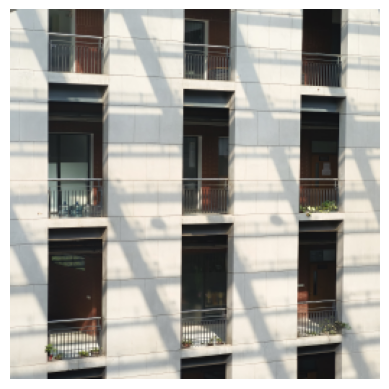 |  |

*Figure 1. The resized input and its grayscale conversion. The weighted sum reduces three color channels to one intensity value per pixel.*

| Salt-and-pepper noise | Gaussian noise |
| --- | --- |
| 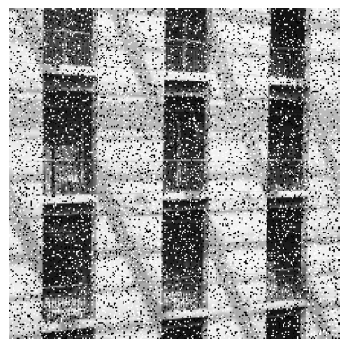 | 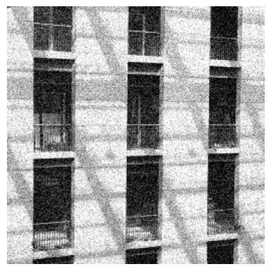 |

*Figure 2. Salt-and-pepper noise assigns selected pixels to 0 or 255; Gaussian noise adds random intensity variations and clips the result to the 8-bit range.*

### Task 1: Image filtering

- **Spatial domain:** apply mean and Gaussian filters with **3 × 3** and **5 × 5** kernels to both noisy images using the notebook's zero-padded filtering function.
- **Frequency domain:** compute a manual, separable 2-D DFT of the Gaussian-noise image, center its spectrum, apply a Gaussian low-pass mask with cutoff parameter `D0 = 30`, and reconstruct the image with a manual IDFT.
- **Comparison:** calculate mean squared error (MSE) and peak signal-to-noise ratio (PSNR) against the clean grayscale reference. Select the result with the highest PSNR among the five Gaussian-noise denoising methods as the input to Task 2.

#### Spatial filtering: computation and observations

The `convolution2d()` function surrounds the image with zeros and slides a kernel over each pixel. At each location, it sums the neighborhood intensities multiplied by their corresponding kernel weights. The output retains the input dimensions.

A mean kernel assigns every entry the same weight, `1 / k²`, for a `k × k` neighborhood. The Gaussian kernel instead uses `exp(-(x² + y²) / (2 × sigma²))` and normalizes its weights to sum to one, placing more weight near the center.

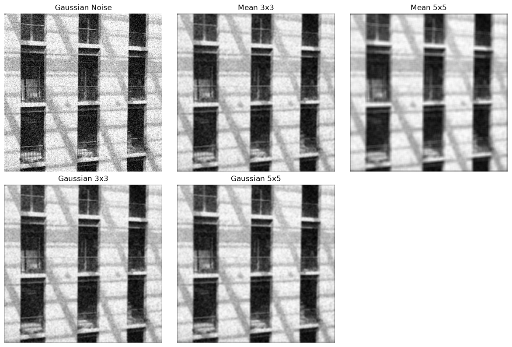

*Figure 3. Gaussian-noise input with mean 3 × 3, mean 5 × 5, Gaussian 3 × 3, and Gaussian 5 × 5 results.*

The filters reduce visible grain by averaging neighboring values. The 5 × 5 mean result also softens window frames and wall details noticeably. Gaussian weighting limits the influence of distant neighbors, preserving more structure than a uniform average in these saved outputs.

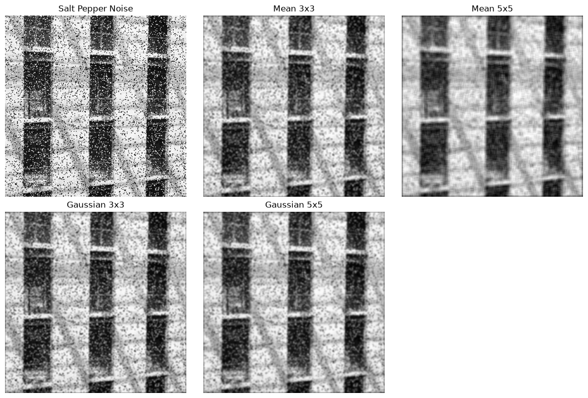

*Figure 4. The same four spatial filters applied to salt-and-pepper noise.*

Impulse noise remains visible after filtering because extreme black and white values influence each neighborhood average. Larger kernels spread those disturbances and blur detail. These results illustrate why the implemented linear filters are less effective for impulse noise; a median filter would be a useful extension.

#### Frequency filtering: computation and observations

The notebook computes the transform in two passes: a 1-D DFT along rows followed by a 1-D DFT along columns. It precomputes sine and cosine values, avoiding repeated trigonometric calculations inside the innermost loops.

1. Compute the complex spectrum with `dft_2d()`.
2. Move the low-frequency components to the center with `shift_complex()`.
3. Construct the Gaussian mask using `H(u, v) = exp(-D(u, v)² / (2 × D0²))`, where `D` is distance from the spectrum center and `D0 = 30`.
4. Multiply the centered spectrum by the mask and shift it back.
5. Reconstruct with `idft_2d()`, round the result, and clip intensities to `[0, 255]` while preserving their scale for evaluation.

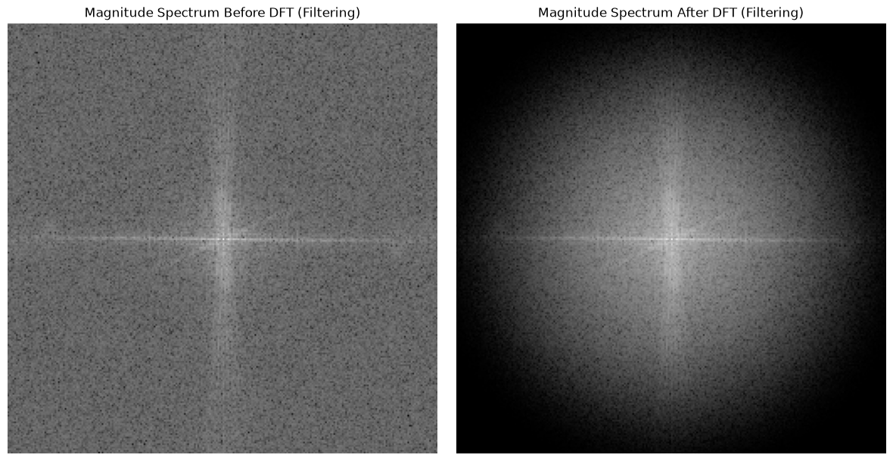

*Figure 5. Centered log-magnitude spectra before filtering (left) and after filtering (right). Both panels show DFT spectra; the plot titles refer to the filtering stage.*

The Gaussian mask gradually attenuates frequencies farther from the center. This reduces high-frequency noise while also removing some fine image detail. A smaller `D0` would produce stronger smoothing.

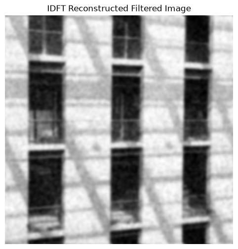

*Figure 6. The filtered image reconstructed from the frequency-domain result using the manual IDFT.*

#### Saved quantitative comparison

These values are copied from the notebook's saved console output. Every method below processes the Gaussian-noise image and uses the clean grayscale image as its reference.

| Denoising method | MSE | PSNR (dB) |
| --- | ---: | ---: |
| Mean 3 × 3 | 282.36 | 23.62 |
| Mean 5 × 5 | 448.14 | 21.62 |
| **Gaussian 3 × 3** | **222.61** | **24.66** |
| Gaussian 5 × 5 | 240.54 | 24.32 |
| Gaussian low-pass filter, `D0 = 30` | 251.78 | 24.12 |

The **Gaussian 3 × 3** filter has the highest saved PSNR and is selected as `best_denoised`. The larger mean filter has the largest error in this comparison, consistent with the loss of detail visible in Figure 3. The selection is computed on every run and can change with the input or generated noise.

### Task 2: Edge detection

- Smooth the selected denoised image with a **5 × 5** Gaussian kernel.
- Compute Sobel gradient magnitude and direction, and a Laplacian response for comparison.
- Implement Canny stages: non-maximum suppression, double thresholding, and iterative edge tracking by hysteresis.
- Compare the low/high threshold pairs **(10, 70)** and **(70, 200)** to examine how thresholds affect edge detail and continuity.

#### Prepare the input

The image selected by Task 1 receives an additional Gaussian smoothing pass before gradient computation. This reduces residual noise that could otherwise create false edge responses.

| Selected denoised input | After Gaussian smoothing |
| --- | --- |
| 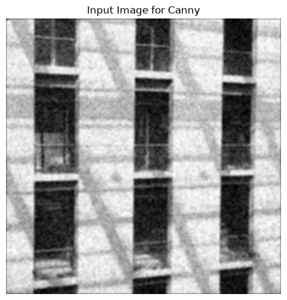 |  |

*Figure 7. Input to edge detection and the smoothed image used for derivative calculations.*

#### Sobel and Laplacian responses

The Sobel kernels estimate horizontal and vertical derivatives, `Gx` and `Gy`. Edge strength is `sqrt(Gx² + Gy²)` and direction is `atan2(Gy, Gx)`, converted to degrees in `[0, 180)`.

```text
Sobel Gx           Sobel Gy          Laplacian
-1  0  1           -1 -2 -1           0  1  0
-2  0  2            0  0  0           1 -4  1
-1  0  1            1  2  1           0  1  0
```

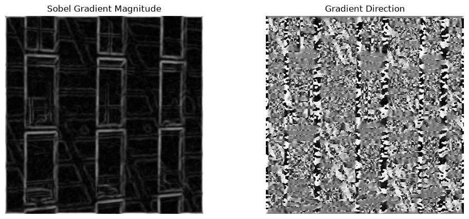

*Figure 8. Sobel gradient magnitude (left) highlights intensity transitions; gradient direction (right) determines the direction used for edge thinning.*

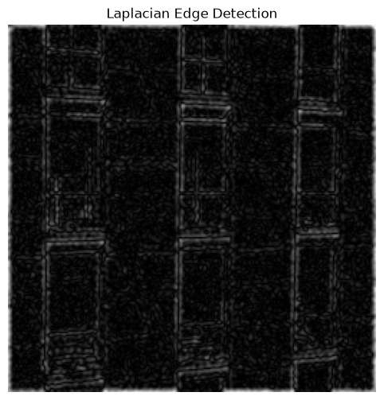

*Figure 9. Absolute Laplacian response clipped for display. The second-derivative operator highlights intensity changes but does not supply the direction needed by Canny.*

#### Canny stage 1: Non-maximum suppression

The algorithm quantizes gradient directions to 0°, 45°, 90°, and 135°. A pixel survives only if its magnitude is at least as large as the two neighboring magnitudes along the selected direction. This thins broad gradient responses before thresholding.

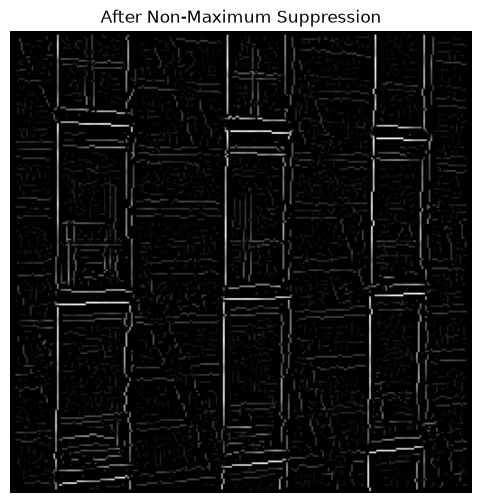

*Figure 10. Non-maximum suppression retains local edge-strength maxima. The image is rescaled for display; thresholding uses the underlying unscaled magnitudes.*

#### Canny stage 2: Double thresholding

Pixels at or above the high threshold become strong edges (`255`). Pixels at or above the low threshold but below the high threshold become weak candidates (`50`); all others become background (`0`).

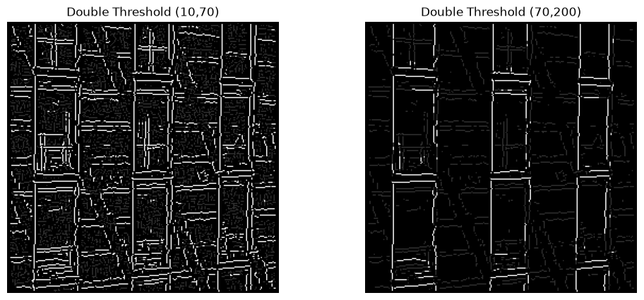

*Figure 11. The lower threshold pair preserves more weak candidates, while the higher pair rejects more low-contrast responses.*

#### Canny stage 3: Hysteresis and final edges

Hysteresis begins with the strong pixels and repeatedly promotes weak pixels connected to them through an 8-neighbor neighborhood. Iteration continues until no more candidates can be connected, allowing chains of weak pixels to survive when they lead to a strong edge.

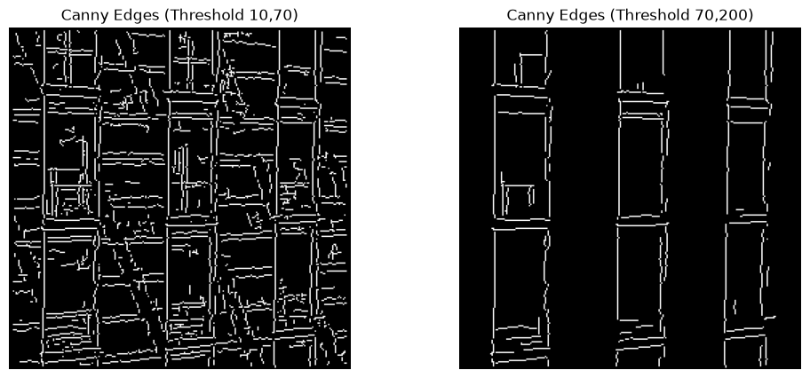

*Figure 12. Final edge maps after hysteresis: (10, 70) on the left and (70, 200) on the right.*

The lower pair retains more wall texture and smaller features along with extra clutter. The higher pair produces a sparser map dominated by window outlines, but faint boundaries and some connections disappear. The notebook uses this second map for morphology.

### Task 3: Morphological processing

- Convert the Canny result for **(70, 200)** into a binary edge map.
- Apply erosion and dilation using **3 × 3 square** and **3 × 3 cross** structuring elements.
- Apply opening (erosion followed by dilation) and closing (dilation followed by erosion) using the square element.

#### Binary input and structuring elements

All nonzero pixels in the second Canny map are converted to white (`255`); background pixels remain black (`0`). The structuring element defines which neighbors participate in each minimum or maximum operation.

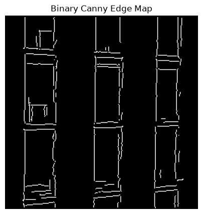

*Figure 13. Binary input to morphological processing.*

```text
Square 3 × 3       Cross 3 × 3
1 1 1              0 1 0
1 1 1              1 1 1
1 1 1              0 1 0
```

#### Erosion and dilation

Erosion takes the minimum intensity under active entries of the structuring element; dilation takes the maximum. The manual implementations pad erosion with `255` and dilation with `0`, then evaluate each neighborhood.

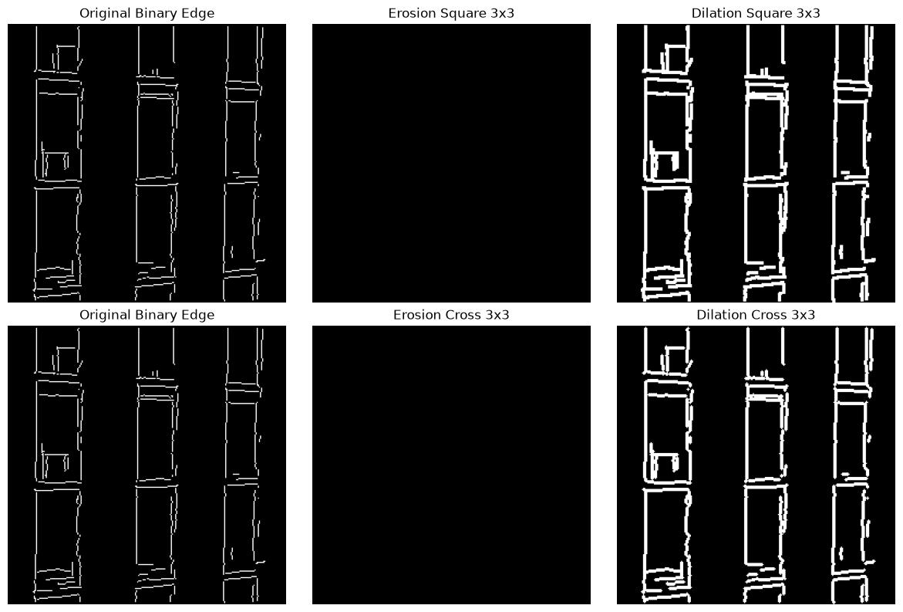

*Figure 14. Original edge map, erosion, and dilation for the square element (top row) and cross element (bottom row).*

The Canny edges are thin, so neither 3 × 3 structuring element fits within the white regions in the saved example: both eroded outputs are empty. Dilation thickens the lines and connects some nearby fragments. The square element includes diagonal neighbors, giving a broader expansion than the cross.

#### Opening and closing

Opening applies erosion followed by dilation, while closing reverses that order. Both use the square element here.

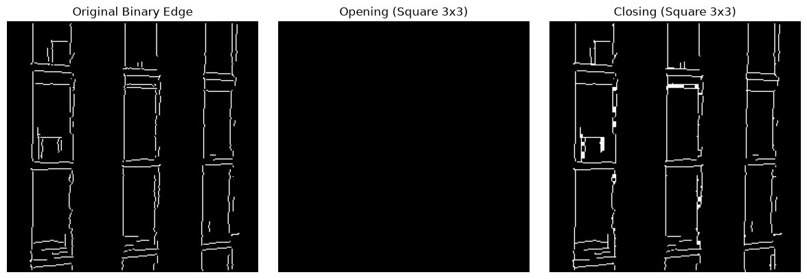

*Figure 15. Original binary edges (left), opening (center), and closing (right).*

Opening cannot recover the edges removed by its initial erosion, leaving an empty result in this example. Closing preserves much of the thin structure and joins some small gaps, making it the more useful operation for this particular edge map.

### Task 4: Otsu thresholding

- Use the **original clean grayscale image**.
- Compute its 256-bin histogram and select the threshold that maximizes between-class variance.
- Display the histogram with the selected threshold and the resulting binary segmentation.

The `compute_histogram()` function counts pixels at every intensity from 0 to 255. For each candidate threshold, `otsu_method()` calculates the background and foreground populations and their mean intensities, then maximizes:

```text
Between-class score = background_count × foreground_count
                      × (background_mean - foreground_mean)²
```

Using counts instead of probabilities scales every candidate score by the same constant, so it does not change which threshold maximizes the score. Once a threshold is selected, `binary_threshold()` assigns intensities greater than or equal to it to `255`, and lower intensities to `0`.

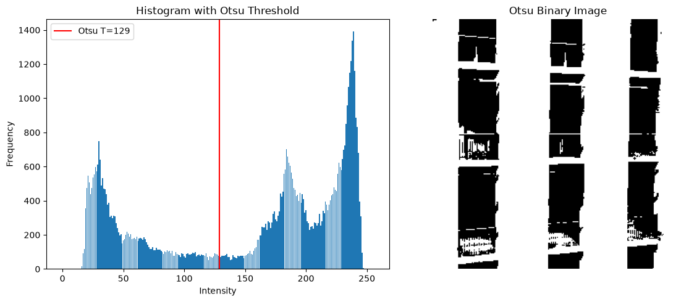

*Figure 16. Otsu selects **T = 129** in the saved output. The red line marks the threshold; the binary image separates dark window regions from brighter wall regions.*

Otsu uses the clean grayscale image independently of the noisy filtering and edge-processing path. This avoids letting the artificially added noise reshape the histogram used for segmentation. The threshold is calculated from the supplied image and may differ on another input.

## Repository contents

| File | Purpose |
| --- | --- |
| [Image_Processing_Code_V3.ipynb](Image_Processing_Code_V3.ipynb) | Executable notebook containing implementations, explanations, and saved outputs. |
| [Image_Processing_Report_V3.pdf](Image_Processing_Report_V3.pdf) | Project report with methodology, figures, discussion, and individual contributions. |
| [docs/images/](docs/images/) | 19 original PNG figures extracted from the notebook's saved outputs and embedded above. |
| [README.md](README.md) | Project overview and instructions for running the notebook. |

**Required local input:** `image.jpg` is referenced by the notebook but is **not included** in this repository. Supply your own color image before running it.

## Setup and execution

### 1. Get the project

Install Python 3 with `pip` and virtual environment support, and Git if you plan to clone the repository. Then run:

```bash
git clone https://github.com/jihadmia35/Image-Processing-Project.git
cd Image-Processing-Project
```

If you already have a local copy, open a terminal in its root directory and continue below.

### 2. Create an environment and install dependencies

On Linux or macOS:

```bash
python3 -m venv .venv
source .venv/bin/activate
```

On Windows PowerShell:

```powershell
py -m venv .venv
.venv\Scripts\Activate.ps1
```

With the environment active, install the notebook dependencies and JupyterLab:

```bash
python -m pip install numpy matplotlib opencv-python jupyterlab ipykernel
```

| Package/module | Role |
| --- | --- |
| `numpy` | Arrays, numerical operations, and random noise generation. |
| `matplotlib` | Image displays, comparison plots, and histograms. |
| `opencv-python` (imported as `cv2`) | Image loading, color conversion, and resizing. |
| `jupyterlab` and `ipykernel` | Notebook interface and Python execution kernel. |
| `math` | Standard-library mathematical functions; no separate installation needed. |

### 3. Add the input image

Place a readable color image named **`image.jpg`** beside the notebook:

```text
Image-Processing-Project/
├── README.md
├── Image_Processing_Code_V3.ipynb
├── Image_Processing_Report_V3.pdf
├── docs/
│   └── images/                       # Saved notebook figures used in this README
└── image.jpg                         # Supply this file locally
```

To use another filename or format supported by OpenCV, change the notebook's loading line:

```python
img = cv2.imread('image.jpg')
```

The path is resolved relative to the notebook kernel's working directory. Keep the default **256 × 256** resize for the initial run, since the manual DFT/IDFT is computationally expensive.

### 4. Run the notebook

```bash
python -m jupyterlab
```

Open **`Image_Processing_Code_V3.ipynb`**, select a Python kernel from the environment where you installed the dependencies, and use **Restart Kernel and Run All Cells**. Run cells from top to bottom because later tasks depend on variables and functions created earlier.

The notebook displays figures inline and prints the MSE/PSNR comparison, selected denoising method, and Otsu threshold. Save the notebook to retain new outputs; the code does not automatically export image files.

## Parameters to explore

Edit the relevant notebook cells, then restart the kernel and run all cells again.

| Parameter | Current experiment setting | What it changes |
| --- | --- | --- |
| Resize dimensions | `256 × 256` | Image detail and computation cost. |
| Gaussian noise | Mean `0`, sigma `25` | Strength of the added Gaussian noise. |
| Salt-and-pepper noise | Salt `0.1`, pepper `0.1` | Approximately 20% of pixels are assigned salt or pepper values. |
| Spatial kernels | Mean/Gaussian, sizes `3` and `5`; Gaussian sigma `1` in Task 1A | Balance between denoising and smoothing detail. |
| Gaussian low-pass mask | `D0 = 30` | Amount of high-frequency attenuation. |
| Canny smoothing | Size `5`, sigma `1` | Smoothing before gradient estimation. |
| Canny threshold pairs | `(10, 70)` and `(70, 200)` | Which weak and strong edges survive. |
| Morphology | Square/cross, size `3 × 3` | Shape and extent of neighborhood operations. |

## Outputs and evaluation

A complete run produces:

- Original, grayscale, and noisy image views.
- Spatial denoising comparisons for both noise types.
- Frequency spectra before and after filtering, plus the reconstructed image.
- An MSE/PSNR comparison for the four spatial filters and the frequency-domain Gaussian filter on Gaussian noise.
- Sobel, Laplacian, intermediate Canny, and final Canny edge views.
- Binary edge maps with erosion, dilation, opening, and closing results.
- A grayscale histogram with the Otsu threshold and the segmented image.

For 8-bit grayscale images, the notebook evaluates denoising using:

```text
MSE  = mean((reference - restored)²)
PSNR = 10 × log10(255² / MSE)
```

Lower MSE and higher PSNR indicate closer agreement with the clean reference. PSNR is infinite when MSE is zero. The selected denoising result is passed automatically to edge detection.

## Reproducibility and limitations

- Noise generation is random and the notebook does not set a random seed. For repeatable noise with the same input image, add `np.random.seed(42)` immediately after the import cell, before any noise is generated, then rerun all cells.
- The original input image is absent, so supplying another image changes the plots, metrics, best filter, and potentially the Otsu threshold.
- The report's metric table differs from the notebook's saved comparison output. Treat them as recorded results and use freshly executed notebook outputs for comparisons in your environment.
- Dependency versions are not pinned. The installation commands provide the required packages without defining an exact reproduction environment.
- Manual DFT/IDFT uses nested Python loops and is slower than an FFT. Its separable implementation costs `O(MN(M + N))` for an `M × N` image, so larger images increase execution time rapidly.
- Zero padding can affect spatial-filter results near image boundaries. Mean and Gaussian filters can blur edges and spread salt-and-pepper impulses.
- Erosion and opening can remove thin Canny edges. A single global Otsu threshold can struggle with uneven illumination.

## Troubleshooting

| Symptom | Action |
| --- | --- |
| OpenCV error at `cv2.cvtColor` when loading the image | Confirm that `image.jpg` exists in the kernel's working directory and that `cv2.imread('image.jpg')` returns an image rather than `None`. |
| `ModuleNotFoundError` for `cv2`, `numpy`, or `matplotlib` | Select the environment used for installation, or install the packages in the current kernel's environment. |
| `NameError` for an image variable or helper function | Restart the kernel and execute every cell in order. |
| Frequency-domain cells take a long time | Keep the default input size and allow the manual DFT/IDFT to finish. |
| Results differ from saved figures or the report | Check the input image, noise seed, and parameter values, then regenerate all outputs together. |

## Team and contributions

Contributions are recorded in the project report.

| Name | Student ID | Contribution |
| --- | --- | --- |
| Jihad Mia | 2023200000505 | Lead, work distribution, and coding. |
| Md Fahim Islam | 2023200000716 | Coding and documentation. |
| Ismail Hossen | 2023200000493 | Mathematics and documentation. |
| Md. Atikur Rahman | 2023200000718 | Mathematics and documentation. |
| Kazi Azmainur Rahman | 2023200000562 | Testing and validation. |

Prepared for the Image Processing course taught by [Mahbub Hasan](https://seu.edu.bd/employee/profile/MDAzMDg1) at Southeast University.
